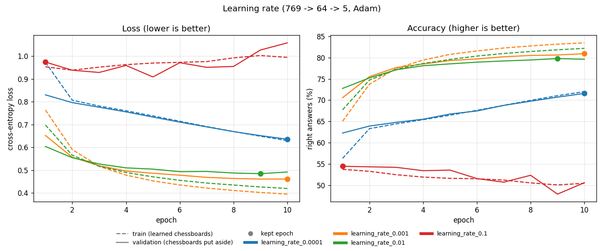
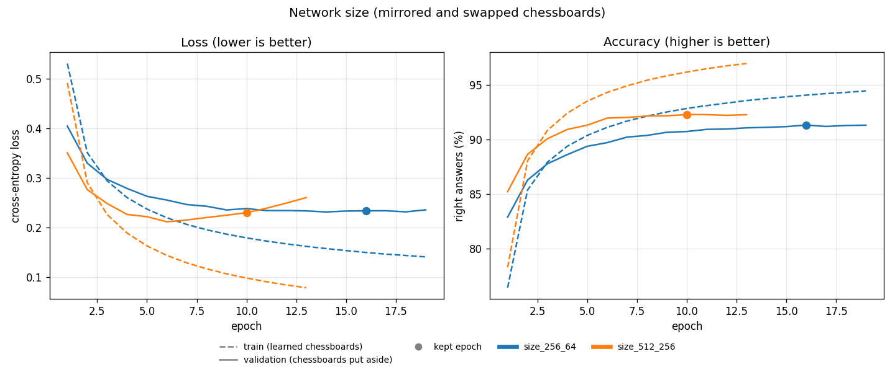
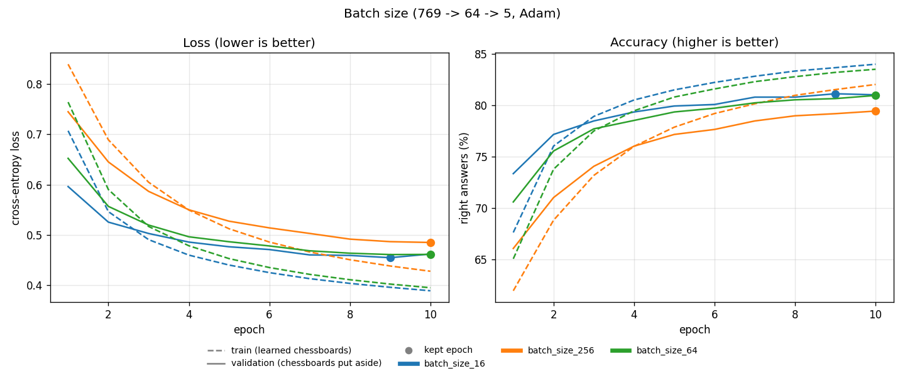
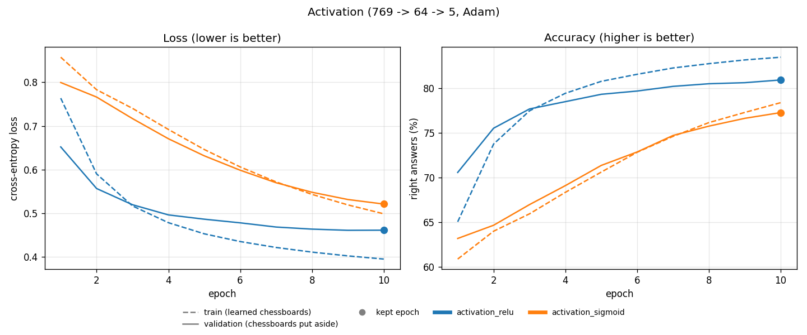
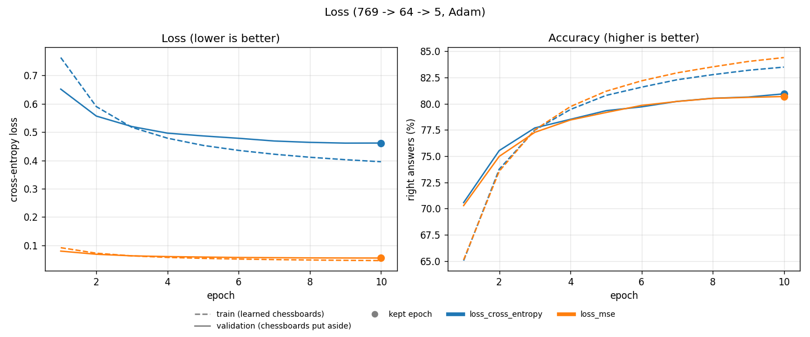

# Results

[← README](../README.md)

1. [Summary](#1-summary)
2. [How to read the graphs](#2-how-to-read-the-graphs)
3. [The pushed network](#3-the-pushed-network)
4. [Starting weights](#4-starting-weights)
5. [Optimizer](#5-optimizer)
6. [Network size](#6-network-size)
7. [More chessboards](#7-more-chessboards)
8. [Mistakes](#8-mistakes)
9. [Other settings](#9-other-settings)

Every setting of the network was chosen by measuring it. All graphs can be made again with `make train` and `make benchmark` ([Usage](usage.md#8-make-the-pushed-network-again)).

## 1. Summary

Share of right answers on chessboards the network has never seen:

| Version | Change | Score |
|---|---|---|
| v0.2.0 | first network | 62.4% |
| v0.2.1 | + better starting weights (He) | 79.1% |
| v0.2.2 | + Adam, bigger network | 83.8% |
| v0.2.3 | + early stopping | 83.3% |
| v0.3.0 | + mirrored chessboards | 87.0% |
| v0.4.0 | + swapped colours, wider network | **92.1%** |

Early stopping does not raise the score, but the network learns less by heart (see [3](#3-the-pushed-network)). Showing each chessboard in a mirror and with its colours swapped raises it the most (see [7](#7-more-chessboards)).

## 2. How to read the graphs

**Epoch** (horizontal axis): one pass of the network over all its chessboards. The graphs show how it changes while it learns.

**Accuracy** (right graph): the share of right answers. **Higher is better.**

**Loss** (left graph): a finer measure of the error. It also counts how sure the network was:

| The right answer is Check White, the network says | Right? | Loss |
|---|---|---|
| Check White at 95% | yes | very small (0.05) |
| Check White at 40% | yes | medium (0.9) |
| Nothing at 90%, Check White at 2% | no | very big (3.9) |

**Lower is better.** The network learns by making its loss smaller.

**Lines**

| Line | Chessboards | Like |
|---|---|---|
| dashed: train | those the network learns from | marks on exercises already done |
| solid: validation | those put aside, never learned | marks at mock exams |

The solid line is what matters: it shows how the network does on new chessboards. **The dot** is the epoch that is kept.

On comparison graphs, **one colour is one network**. The networks are the same except for one setting: the best one is the colour whose solid line ends highest on the right graph.

## 3. The pushed network

- **Right graph**: the dashed line climbs to 97%, but the solid line flattens around 92% after epoch 6. The gap between them is the network **learning by heart**.
- **Left graph**: the solid loss goes slowly back up after epoch 6. The network gets too sure of itself on chessboards it does not know.
- **The dot**: epoch 10 has the best score on the chessboards put aside (92.3%), so it is kept. The training stopped 3 epochs later.

The best epoch is chosen by **accuracy**, not loss: the grader counts right answers. In v0.2.3, chosen by loss, epoch 4 would have been kept, with 82.6% instead of 83.5%.

**Patience of 3 epochs**: in our trainings, a better epoch sometimes came one epoch after an epoch without progress (epoch 11 of the mirrored training, after epoch 10), and always by 0.2 point or less. Three epochs leave room for that, then stop: the network only learns more by heart, and each epoch of the pushed network takes 4 minutes.

Early stopping, measured in v0.2.3: compared with 20 epochs without it, the gap between train and validation went down from 13.7 to 10.8 points, for the same score.

The 10% put aside during training come from `train.txt`, so they can hold the mirror of a learned chessboard: the solid line is a little optimistic. The scores of this page are measured on `validation.txt` and `test.txt`, which have no mirror.

## 4. Starting weights

Four identical small networks, only their starting weights differ:

| Starting weights | Validation |
|---|---|
| uniform (between -1 and 1) | 61.9% |
| LeCun | 78.7% |
| Xavier | 78.2% |
| **He** | **78.8%** |

- **Green** (uniform) stays far below: its weights are too big, so the totals of the neurons explode and the network learns badly.
- The **three others** scale the weights to the number of inputs: +17 points. They are so close that their lines overlap.
- **He** is chosen: it is made for `ReLU`, and is the best by a little.

## 5. Optimizer

Two identical small networks, one corrected by SGD, the other by Adam:

| Optimizer | Validation |
|---|---|
| SGD | 78.8% |
| **Adam** | **80.5%** |

- **Blue** (Adam) is above from the first epoch.
- Adam gives each weight its own step size. Many of our weights are rarely used (only about 20 of the 769 inputs are 1 on a chessboard), and Adam pushes them more.
- **Adam** is chosen. It is 1.5 times slower per epoch, and learns by heart a bit faster, which early stopping handles.

### Learning rate

The learning rate is the size of each correction. Same small network with Adam, four learning rates:

| Learning rate | Validation |
|---|---|
| 0.0001 | 71.4% |
| **0.001** | **80.5%** |
| 0.01 | 79.6% |
| 0.1 | 54.2% |

- **Blue** (0.0001): steps too small. It still goes down after 10 epochs, slowly: it would need many more epochs.
- **Red** (0.1): steps too big. The weights jump over the good values, and the network gets worse than at epoch 1.
- **Orange** (0.001) and **green** (0.01) learn fast. Green is better at the start, then flattens lower and learns a bit more by heart.
- **0.001** is chosen, the usual value for Adam. The pushed network uses it too.

## 6. Network size

On the first dataset (572,443 chessboards):

| Network | Validation |
|---|---|
| 769 → 64 → 5 | 81.4% |
| **769 → 256 → 64 → 5** | **83.6%** |

With He and Adam, the bigger network gains 2 points. With the first settings, it was not better (61.1% against 61.9%): a bigger network only helps once it learns well.

On the dataset with mirrored and swapped chessboards (2,275,920, see [7](#7-more-chessboards)):

| Network | Learned (kept epoch) | Validation | Gap | Test | Training |
|---|---|---|---|---|---|
| 769 → 256 → 64 → 5 | 94.1% | 91.4% | 2.7 | 91.4% | 31 min |
| **769 → 512 → 256 → 5** | 96.2% | **92.1%** | 4.1 | **92.1%** | 54 min |

- **Orange** (wider) is above from the first epoch, then flattens after epoch 6.
- Its dashed line climbs higher: it learns more by heart, and early stopping keeps epoch 10.
- It is kept: +0.7 point. It finds more checks and fewer false checkmates, and takes a few more checkmates for checks.

## 7. More chessboards

Two changes of a chessboard keep its answer, so `make dataset` adds them to `train.txt`:

- **Mirror**: columns a and h swapped, b and g... A check stays a check, by the same colour.
- **Swapped colours**: the board upside down and every piece of the other colour. The other side plays, so Check White becomes Check Black. The network sees each check with both colours, instead of learning them apart.

They are never added to `validation.txt` or `test.txt`, and a copy that is already in one of them is skipped.

Same network (769 → 256 → 64 → 5, He, Adam), with more and more training chessboards:

| Training chessboards | Count | Learned (kept epoch) | Validation | Gap | Test |
|---|---|---|---|---|---|
| none added | 572,443 | 93.2% | 83.5% | 9.7 | 83.3% |
| + mirrors | 1,141,784 | 92.6% | 87.0% | 5.6 | 87.0% |
| **+ mirrors and swapped colours** | **2,275,920** | 94.1% | **91.4%** | **2.7** | **91.4%** |

- Each step is above the previous one on the right graph, from the first epoch.
- The gap between the dashed and solid lines gets smaller: the network learns less by heart.
- On the left graph, the solid loss of the first network goes back up from epoch 4; with all the copies it stays flat.
- Training takes longer: 7, 9, then 31 minutes.

Both are kept: +8.1 points on the test, and the gap is divided by 3.5.

## 8. Mistakes

How to read it:

- each **row** is the right answer, each **column** the answer of the network;
- the **diagonal** (dark green) holds the right answers;
- every other cell is a mistake. For example, row Checkmate Black, column Check Black: 9.0% of the Black checkmates were taken for Black checks.

| Answer | Found |
|---|---|
| Nothing | 96.0% |
| Check White | 88.7% |
| Check Black | 89.3% |
| Checkmate White | 89.3% |
| Checkmate Black | 90.6% |

What it shows:

- The network **almost never mixes up the colours** (3 times out of 71,556 test chessboards): the side to move is one of its inputs.
- Its mistakes are telling a **check from a checkmate**: to know that the king cannot escape, it must see every square around it. Then telling a **check from nothing**: it must see that two far pieces are on the same line with nothing between them.

## 9. Other settings

Same small network as for the optimizer (769 → 64 → 5, He, Adam, learning rate 0.001, 10 epochs), one setting changed at a time.

### Batch size

The number of chessboards learned before each correction.

| Batch size | Validation | Training |
|---|---|---|
| 16 | 81.2% | 2.3 min |
| **64** | **80.5%** | **1.5 min** |
| 256 | 79.5% | 0.8 min |

- Smaller batches make more corrections per epoch, so they learn a bit more in 10 epochs, but NumPy works on smaller arrays and it is slower.
- **64** is kept as a compromise: 0.7 point below 16, but 1.5 times faster. On the pushed network, 16 would turn a 54-minute training into about 80 minutes.

### Activation

| Activation | Validation |
|---|---|
| **ReLU** | **80.5%** |
| Sigmoid | 77.1% |

- **ReLU** is kept: 3.4 points better. Sigmoid squashes big totals to almost 1, where it hardly changes: the corrections that go back through it become tiny and the network learns slower.
- He starting weights are made for ReLU.

### Loss

| Loss | Validation |
|---|---|
| **Cross-entropy** | **80.5%** |
| MSE | 80.7% |

- The two give the same accuracy here (0.2 point apart). Their loss values are not on the same scale, so only the right graph can compare them.
- **Cross-entropy** is kept: it is made for choosing one answer among several after Softmax, and its value tells how sure the network was of the right answer (see [2](#2-how-to-read-the-graphs)).
