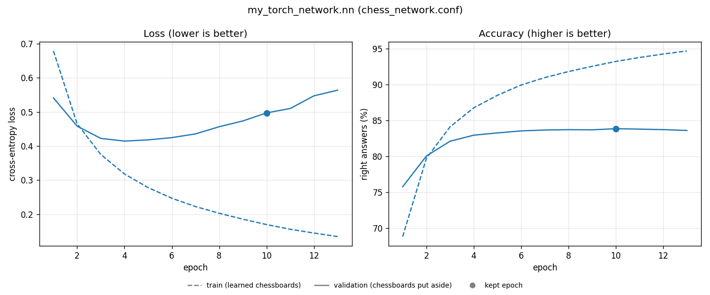
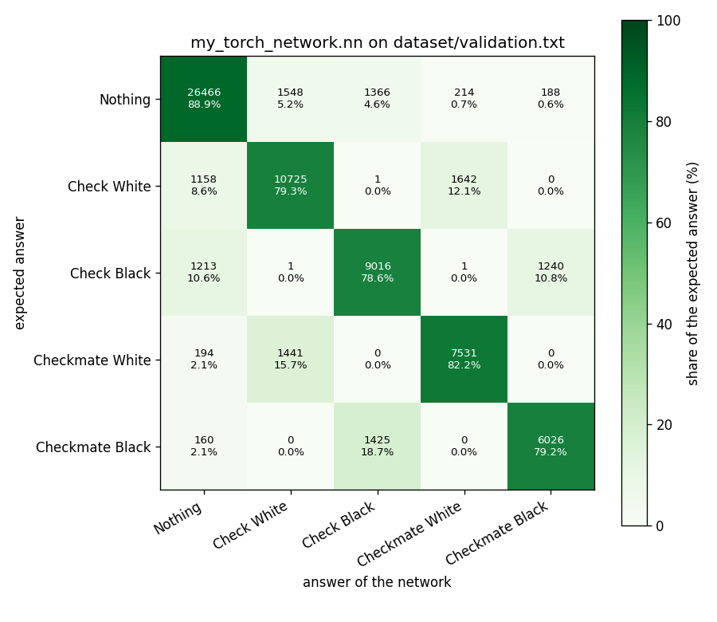

# Results

[← README](../README.md)

1. [Summary](#1-summary)
2. [How to read the graphs](#2-how-to-read-the-graphs)
3. [The pushed network](#3-the-pushed-network)
4. [Starting weights](#4-starting-weights)
5. [Optimizer](#5-optimizer)
6. [Network size](#6-network-size)
7. [Mistakes](#7-mistakes)

Every setting of the network was chosen by measuring it. All graphs can be made again with `make train` and `make benchmark` ([Usage](usage.md#8-make-the-pushed-network-again)).

## 1. Summary

Share of right answers on chessboards the network has never seen:

| Version | Change | Score |
|---|---|---|
| v0.2.0 | first network | 62.4% |
| v0.2.1 | + better starting weights (He) | 79.1% |
| v0.2.2 | + Adam, bigger network | 83.8% |
| v0.2.3 | + early stopping | 83.3% |

Early stopping does not raise the score, but the network learns much less by heart (see [3](#3-the-pushed-network)).

## 2. How to read the graphs

**Epoch** (horizontal axis): one pass of the network over all its chessboards. The graphs show how it changes while it learns.

**Accuracy** (right graph): the share of right answers. **Higher is better.**

**Loss** (left graph): a finer measure of the error. It also counts how sure the network was:

| The right answer is Check White, the network says | Right? | Loss |
|---|---|---|
| Check White at 95% | yes | very small (0.05) |
| Check White at 40% | yes | medium (0.9) |
| Nothing at 90%, Check White at 2% | no | very big (3.9) |

**Lower is better.** The network learns by making its loss smaller.

**Lines**

| Line | Chessboards | Like |
|---|---|---|
| dashed: train | those the network learns from | marks on exercises already done |
| solid: validation | those put aside, never learned | marks at mock exams |

The solid line is what matters: it shows how the network does on new chessboards. **The dot** is the epoch that is kept.

On comparison graphs, **one colour is one network**. The networks are the same except for one setting: the best one is the colour whose solid line ends highest on the right graph.

## 3. The pushed network

- **Right graph**: the dashed line climbs to 95%, but the solid line stops around 83% after epoch 4. The gap between them is the network **learning by heart**.
- **Left graph**: the solid loss goes back up after epoch 4. The network gets too sure of itself on chessboards it does not know.
- **The dot**: epoch 10 has the best score on the chessboards put aside (83.9%), so it is kept. The training stopped 3 epochs later.

The best epoch is chosen by **accuracy**, not loss: the grader counts right answers. Chosen by loss, epoch 4 would be kept, with 82.6% instead of 83.5%.

Compared with 20 epochs without early stopping, the gap between train and validation goes down from 13.7 to 10.8 points, for the same score.

## 4. Starting weights

Four identical small networks, only their starting weights differ:

| Starting weights | Validation |
|---|---|
| uniform (between -1 and 1) | 61.9% |
| LeCun | 78.7% |
| Xavier | 78.2% |
| **He** | **78.8%** |

- **Green** (uniform) stays far below: its weights are too big, so the totals of the neurons explode and the network learns badly.
- The **three others** scale the weights to the number of inputs: +17 points. They are so close that their lines overlap.
- **He** is chosen: it is made for `ReLU`, and is the best by a little.

## 5. Optimizer

Two identical small networks, one corrected by SGD, the other by Adam:

| Optimizer | Validation |
|---|---|
| SGD | 78.8% |
| **Adam** | **80.5%** |

- **Blue** (Adam) is above from the first epoch.
- Adam gives each weight its own step size. Many of our weights are rarely used (only about 20 of the 769 inputs are 1 on a chessboard), and Adam pushes them more.
- **Adam** is chosen. It is 1.5 times slower per epoch, and learns by heart a bit faster, which early stopping handles.

## 6. Network size

| Network | Validation |
|---|---|
| 769 → 64 → 5 | 81.4% |
| **769 → 256 → 64 → 5** | **83.6%** |

With He and Adam, the bigger network gains 2 points. With the first settings, it was not better (61.1% against 61.9%): a bigger network only helps once it learns well.

## 7. Mistakes

How to read it:

- each **row** is the right answer, each **column** the answer of the network;
- the **diagonal** (dark green) holds the right answers;
- every other cell is a mistake. For example, row Checkmate Black, column Check Black: 18.7% of the Black checkmates were taken for Black checks.

| Answer | Found |
|---|---|
| Nothing | 88.9% |
| Check White | 79.3% |
| Check Black | 78.6% |
| Checkmate White | 82.2% |
| Checkmate Black | 79.2% |

What it shows:

- The network **never mixes up the colours**: the side to move is one of its inputs.
- Its mistakes are telling a **check from a checkmate**, and a **check from nothing**. To see a check, it must see that two far pieces are on the same line with nothing between them: the hardest thing to learn.
